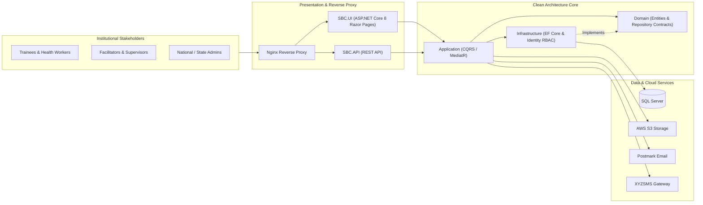

# SBC — Social & Behavior Change Capacity Building & Certification MIS

[](https://dotnet.microsoft.com/)
[](#system-architecture)
[](#technology-stack)
[](#technology-stack)
[](#ci-cd--security-posture)

An institutional **Social and Behavior Change (SBC) Training, Evaluation, and Digital Certification Management Information System (MIS)** built on **.NET 8 Clean Architecture** to support public-health nutrition and community-engagement workforce programs under **Federal Ministry of Health and Social Welfare** standards.

The platform centralizes multi-state training administration, facilitator and participant categorization, pre-/post-training competency assessments, daily quality-assurance evaluations, and verifiable certificate generation.

---

## Key Capabilities

- **Categorized Workforce & Facilitator Management**: Tracks facilitators, supervisors, and participants across specialized public-health categories (`ProfileCategory`, `ParticipantAndFacilitatorByCategoryDto`) and regional deployments.
- **Standardized Competency Evaluation**: Delivers structured pre-tests and post-tests (`TrainingTest`, `TestCategory`, `TestSheet`, `UserTest`) alongside daily participant evaluations (`DialyEvaluationQuestion`, `DialyUserEvaluation`) and supervisor field checklists.
- **Automated Credentialing**: Generates official, verifiable completion certificates (`Certificate`, `Rotativa.AspNetCore`) tied to attendance and assessment thresholds.
- **Clean Architecture & CQRS**: Engineered with strict separation across `Domain`, `Application` (`MediatR`), `Infrastructure` (EF Core 8), cloud/messaging adapters (`AWS`, `PostmarkEmailService`, `XYZSMS`), and `SBC.UI`.

---

## System Architecture



---

## Repository Structure

```text
SBC/
├── .github/workflows/
│   └── deploy.yml                 # Automated Linux x64 CI/CD build, SSH transfer & service restart
├── src/
│   ├── Domain/                    # Entities, enums, analytics DTOs, and repository interfaces
│   ├── Application/               # CQRS Commands, Queries, and MediatR handlers
│   ├── Infrastructure/            # EF Core 8 DbContext, migrations, and SQL Server repositories
│   ├── API/                       # Companion REST API layer
│   ├── AWS/                       # Amazon S3 file/document management service
│   └── PostmarkEmailService/      # Transactional email integration
├── XYZSMS/                        # SMS gateway client library
├── UI/
│   └── SBC.UI/                    # Primary ASP.NET Core 8 Razor Pages web application
├── tests/
│   └── Test/                      # Unit & integration test project
├── .env.example                   # Sanitized environment variable template
├── deploy.sh                      # Zero-downtime systemd setup, port discovery & HTTP health probe
└── SBC.sln                        # Visual Studio Solution
```

---

## Technology Stack

- **Platform**: C#, .NET 8, ASP.NET Core Razor Pages & Web API
- **Architecture**: Clean Architecture, CQRS (`MediatR`), Repository Pattern
- **Database**: Microsoft SQL Server, Entity Framework Core 8
- **Security**: ASP.NET Core Identity (`AppUser`, `AppRole`), RBAC, Environment-Isolated `.env` Secrets
- **Cloud & Comms**: Amazon S3, Postmark Email API, XYZSMS Gateway, `Rotativa.AspNetCore`
- **DevOps**: GitHub Actions CI/CD, Linux `systemd`, Bash (`deploy.sh`), Nginx

---

## Local Setup Instructions

### 1. Clone & Configure Environment
```bash
git clone https://github.com/SirP-TechHub-0904/SBC.git
cd SBC
cp .env.example UI/SBC.UI/.env
```
Update `UI/SBC.UI/.env` with your local SQL Server connection string and service keys:
```ini
ConnectionStrings__AppConnection="Server=localhost;Database=db_sbc_dev;Trusted_Connection=True;TrustServerCertificate=True;"
PostmarkSettings__ServerToken="your_postmark_token_here"
AwsConfiguration__AWSAccessKey="your_aws_access_key_here"
AwsConfiguration__AWSSecretKey="your_aws_secret_key_here"
```

### 2. Build, Migrate & Launch
```bash
dotnet restore SBC.sln
dotnet build SBC.sln --configuration Release
dotnet ef database update --project src/Infrastructure --startup-project UI/SBC.UI
dotnet run --project UI/SBC.UI
```

---

## CI/CD & Security Posture

- **Zero Secrets in Source Control**: All credentials are loaded at runtime via `.env` / `systemd` `EnvironmentFile=-/var/www/sbc/.env` (`chmod 600`).
- **Automated Health Verification**: [`deploy.sh`](deploy.sh) preserves live server environment secrets across releases, configures `sbc.service`, and validates HTTP `200`/`302` responsiveness before completing deployment.

---

## Author

**Peter Emeka Onwuka**  
Chief Technology Officer & Enterprise Systems Architect  
- GitHub: [@SirP-TechHub-0904](https://github.com/SirP-TechHub-0904)  
- LinkedIn: [Peter Emeka Onwuka](https://www.linkedin.com/in/onwuka-peter-emeka)

